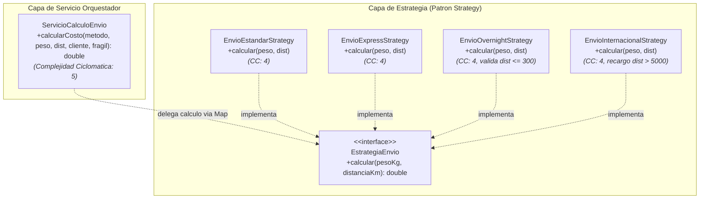
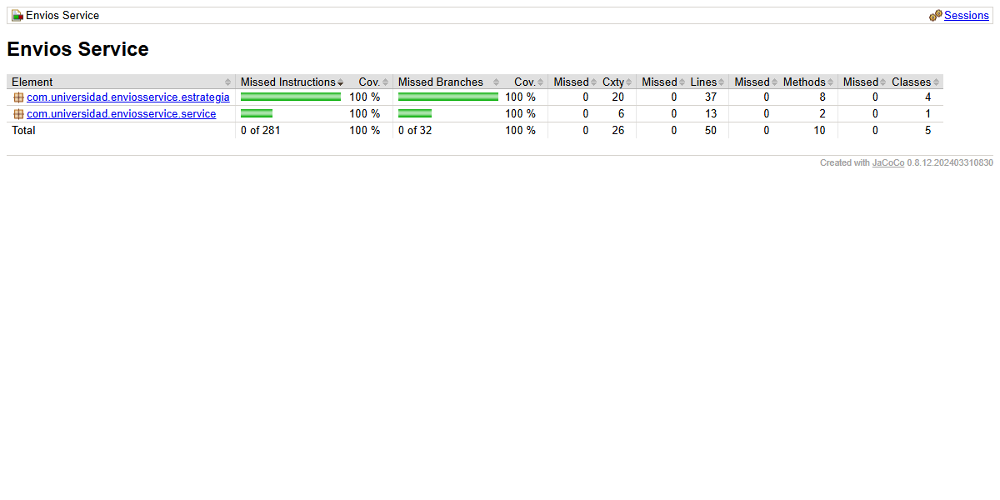
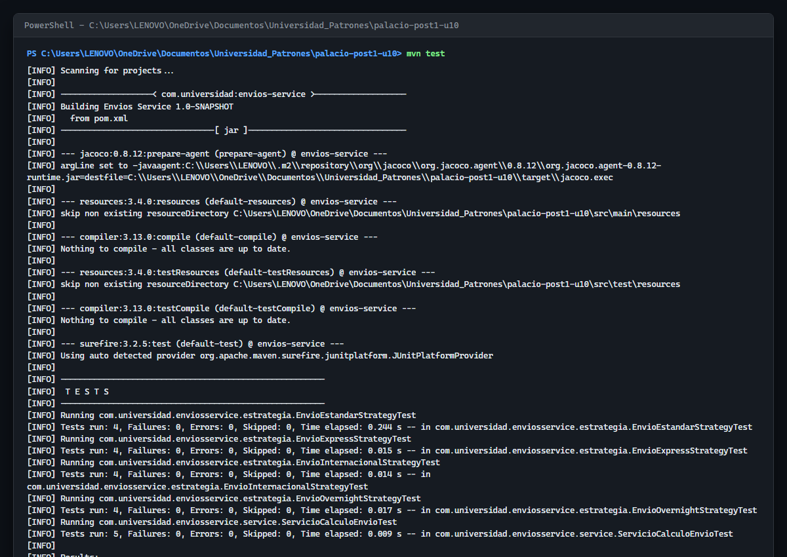

# Envios Service - Diagnostico y Mejora Guiada por Metricas Reales

**Estudiante:** Nicolas Andres Palacio Boada  
**Programa:** Ingenieria de Sistemas  
**Institucion:** Universidad de Santander (UDES), Sede Cucuta  
**Asignatura:** Patrones de Diseno de Software  
**Docente:** Jonathan Rolando Rey Castillo  
**Unidad 10:** Metricas de Calidad y SonarQube: Diagnostico y Mejora Guiada por Metricas Reales  

---

## Tabla de Contenido

- [1. Descripcion General del Sistema](#1-descripcion-general-del-sistema)
- [2. Arquitectura de Software y Refactorizacion](#2-arquitectura-de-software-y-refactorizacion)
  - [2.1 Diagrama de Componentes y Clases](#21-diagrama-de-componentes-y-clases)
  - [2.2 Diagrama de Secuencia del Flujo Polimorfico](#22-diagrama-de-secuencia-del-flujo-polimorfico)
  - [2.3 Arbol de Directorios Comentado](#23-arbol-de-directorios-comentado)
- [3. Comparacion de Codigo: Antes vs Despues (Bloque Diff)](#3-comparacion-de-codigo-antes-vs-despues-bloque-diff)
- [4. Tabla de Contratos e Interfaces Publicas](#4-tabla-de-contratos-e-interfaces-publicas)
- [5. Decisiones de Diseno Arquitectonico (ADRs)](#5-decisiones-de-diseno-arquitectonico-adrs)
  - [5.1 Decision 1: Entorno de Analisis (SonarQube vs SonarCloud)](#51-decision-1-entorno-de-analisis-sonarqube-vs-sonarcloud)
  - [5.2 Decision 2: Politica de Exclusiones del Analisis](#52-decision-2-politica-de-exclusiones-del-analisis)
  - [5.3 Decision 3: Metrica Usada como Senal Principal de Diagnostico](#53-decision-3-metrica-usada-como-senal-principal-de-diagnostico)
  - [5.4 Decision 4: Seleccion del Patron de Diseno de Comportamiento](#54-decision-4-seleccion-del-patron-de-diseno-de-comportamiento)
  - [5.5 Decision 5: Criterio de Pruebas Agregadas y Prevencion de Cobertura Vacia](#55-decision-5-criterio-de-pruebas-agregadas-y-prevencion-de-cobertura-vacia)
  - [5.6 Decision 6: Realismo y Calibracion de los Umbrales del Quality Gate](#56-decision-6-realismo-y-calibracion-de-los-umbrales-del-quality-gate)
- [6. Tabla Comparativa de Metricas: Antes (Parte 1) vs Despues (Parte 2)](#6-tabla-comparativa-de-metricas-antes-parte-1-vs-despues-parte-2)
- [7. Guia de Ejecucion Paso a Paso](#7-guia-de-ejecucion-paso-a-paso)
- [8. Evidencias de Ejecucion y Pruebas Reales](#8-evidencias-de-ejecucion-y-pruebas-reales)
- [9. Herramientas Utilizadas](#9-herramientas-utilizadas)
- [10. Conclusiones](#10-conclusiones)

---

## 1. Descripcion General del Sistema

El proyecto `envios-service` es una aplicacion Java pura concebida para liquidar con precision las tarifas logisticas de despacho de paquetes comerciales en funcion de multiples dimensiones: modalidad de envio (`ESTANDAR`, `EXPRESS`, `OVERNIGHT`, `INTERNACIONAL`), peso de la carga en kilogramos, distancia de transporte en kilometros, atributos fisicos (fragilidad) y categoria de cliente (`REGULAR`, `PREMIUM`, `CORPORATIVO`).

El ciclo de desarrollo cierra integralmente las dos fases del laboratorio:
1. **Parte 1 (Diagnostico con Metricas Reales):** Implementacion de una clase de servicio monolitica (`ServicioCalculoEnvio`) que deliberadamente concentraba una complejidad ciclomatica critica (CC = 20) y una suite de pruebas precaria con baja cobertura de ramas (18.4%), diagnosticando la raiz estructural mediante JaCoCo y SonarQube.
2. **Parte 2 (Mejora Guiada por Metricas):** Descomposicion del metodo procedimental aplicando el patron GoF **Strategy**, aislando cada politica de calculo en su propia clase, manteniendo las politicas comerciales transversales en la clase orquestadora, elevando la cobertura de ramas al 100% con pruebas parametrizadas rigurosas y verificando el cumplimiento de un Quality Gate exigente y realista.

---

## 2. Arquitectura de Software y Refactorizacion

### 2.1 Diagrama de Componentes y Clases

La arquitectura refactorizada desacopla la orquestacion del calculo algoritmico individual:



### 2.2 Diagrama de Secuencia del Flujo Polimorfico

```mermaid
sequenceDiagram
    autonumber
    actor Cliente as Invocador / Test
    participant Servicio as ServicioCalculoEnvio
    participant Map as Map&lt;String, EstrategiaEnvio&gt;
    participant Strategy as EstrategiaEnvio (Concreta)

    Cliente->>Servicio: calcularCosto(metodoEnvio, pesoKg, distanciaKm, tipoCliente, esFragil)
    Servicio->>Map: get(metodoEnvio)
    alt Metodo de envio soportado
        Map-->>Servicio: EstrategiaEnvio adecuada
        Servicio->>Strategy: calcular(pesoKg, distanciaKm)
        alt Distancia valida (e.g. Overnight &lt;= 300 km)
            Strategy-->>Servicio: costoBase
        else Distancia invalida
            Strategy-->>Servicio: throws IllegalArgumentException
        end
        Note over Servicio: Aplica recargo de fragilidad (+15%) si esFragil es true
        Note over Servicio: Aplica descuento comercial: PREMIUM (-10%) o CORPORATIVO (-15%)
        Servicio-->>Cliente: costoFinal (double)
    else Metodo no soportado
        Map-->>Servicio: null
        Servicio-->>Cliente: throws IllegalArgumentException("Metodo de envio no soportado")
    end
```

### 2.3 Arbol de Directorios Comentado

```text
palacio-post1-u10/
|-- docs/
|   |-- adr/
|   |   |-- ADR-001.md               # Seleccion de entorno: SonarQube local vs SonarCloud
|   |   |-- ADR-002.md               # Politica de exclusiones del analisis estatico
|   |   |-- ADR-003.md               # Senal principal: Complejidad Ciclomatica (CC = 20)
|   |   |-- ADR-004.md               # Seleccion de patron: Strategy vs State vs Chain of Responsibility
|   |   |-- ADR-005.md               # Criterio de pruebas agregadas y prevencion de cobertura vacia
|   |   `-- ADR-006.md               # Realismo y calibracion de umbrales del Quality Gate
|   |-- capturas/
|   |   |-- 01-jacoco-inicial.png    # Evidencia JaCoCo Parte 1 (CC = 20, Cobertura = 18.4%)
|   |   |-- 02-jacoco-final.png      # Evidencia JaCoCo Parte 2 (CC = 5, Cobertura = 100%)
|   |   `-- 03-mvn-test-final.png    # Evidencia terminal: 21 pruebas en verde y BUILD SUCCESS
|   `-- GUIA_DE_PRUEBAS.md           # Catalogo detallado de casos de prueba y aserciones
|-- src/
|   |-- main/
|   |   `-- java/
|   |       `-- com/universidad/enviosservice/
|   |           |-- estrategia/
|   |           |   |-- EnvioEstandarStrategy.java      # Estrategia estandar (CC = 4)
|   |           |   |-- EnvioExpressStrategy.java       # Estrategia express (CC = 4)
|   |           |   |-- EnvioInternacionalStrategy.java # Estrategia internacional (CC = 4)
|   |           |   |-- EnvioOvernightStrategy.java     # Estrategia nocturna con limite 300 km (CC = 4)
|   |           |   `-- EstrategiaEnvio.java            # Interfaz base de la estrategia
|   |           `-- service/
|   |               `-- ServicioCalculoEnvio.java       # Orquestador refactorizado (CC = 5)
|   `-- test/
|       `-- java/
|           `-- com/universidad/enviosservice/
|               |-- estrategia/
|               |   |-- EnvioEstandarStrategyTest.java      # Pruebas parametrizadas de estandar
|               |   |-- EnvioExpressStrategyTest.java       # Pruebas parametrizadas de express
|               |   |-- EnvioInternacionalStrategyTest.java # Pruebas parametrizadas de internacional
|               |   `-- EnvioOvernightStrategyTest.java     # Pruebas de overnight y excepcion
|               `-- service/
|                   `-- ServicioCalculoEnvioTest.java       # Pruebas unitarias del orquestador
|-- .gitignore                       # Exclusion de target/, temporales y metadatos
|-- pom.xml                          # Configuracion Maven con JUnit 5, JaCoCo y Sonar plugin
|-- README.md                        # Documentacion integral del laboratorio
`-- sonar-project.properties         # Parametros de configuracion para SonarQube / SonarCloud
```

---

## 3. Comparacion de Codigo: Antes vs Despues (Bloque Diff)

La siguiente comparacion formal ilustra el punto de quiebre arquitectonico donde se desmantelo el metodo procedimental de 20 caminos para sustituirlo por el orquestador polimorfico limpio:

```diff
--- src/main/java/com/universidad/enviosservice/service/ServicioCalculoEnvio.java (Parte 1: Monolitico, CC = 20)
+++ src/main/java/com/universidad/enviosservice/service/ServicioCalculoEnvio.java (Parte 2: Refactorizado con Strategy, CC = 5)
@@ -1,70 +1,38 @@
 package com.universidad.enviosservice.service;
 
+import com.universidad.enviosservice.estrategia.EstrategiaEnvio;
+import com.universidad.enviosservice.estrategia.EnvioEstandarStrategy;
+import com.universidad.enviosservice.estrategia.EnvioExpressStrategy;
+import com.universidad.enviosservice.estrategia.EnvioOvernightStrategy;
+import com.universidad.enviosservice.estrategia.EnvioInternacionalStrategy;
+import java.util.Map;
+
 public class ServicioCalculoEnvio {
 
+    private final Map<String, EstrategiaEnvio> estrategias = Map.of(
+        "ESTANDAR", new EnvioEstandarStrategy(),
+        "EXPRESS", new EnvioExpressStrategy(),
+        "OVERNIGHT", new EnvioOvernightStrategy(),
+        "INTERNACIONAL", new EnvioInternacionalStrategy()
+    );
+
     public double calcularCosto(String metodoEnvio, double pesoKg, double distanciaKm,
                                 String tipoCliente, boolean esFragil) {
-        double costo;
-
-        if (metodoEnvio.equals("ESTANDAR")) {
-            if (pesoKg <= 5) {
-                costo = distanciaKm * 0.5;
-            } else if (pesoKg <= 20) {
-                costo = distanciaKm * 0.5 + (pesoKg - 5) * 0.8;
-            } else {
-                costo = distanciaKm * 0.5 + 15 * 0.8 + (pesoKg - 20) * 1.2;
-            }
-            if (distanciaKm > 500) {
-                costo += 10;
-            }
-        } else if (metodoEnvio.equals("EXPRESS")) {
-            // ... tramos anidados repetidos ...
-        } else if (metodoEnvio.equals("OVERNIGHT")) {
-            // ... tramos anidados y validacion distancia ...
-        } else if (metodoEnvio.equals("INTERNACIONAL")) {
-            // ... tramos anidados y recargo ...
-        } else {
-            throw new IllegalArgumentException("Metodo de envio no soportado: " + metodoEnvio);
-        }
+        EstrategiaEnvio estrategia = estrategias.get(metodoEnvio);
+        if (estrategia == null) {
+            throw new IllegalArgumentException("Metodo de envio no soportado: " + metodoEnvio);
+        }
+
+        // Delegacion polimorfica al algoritmo especializado
+        double costo = estrategia.calcular(pesoKg, distanciaKm);
 
+        // Reglas comerciales transversales preservadas sin duplicacion
         if (esFragil) {
             costo = costo + costo * 0.15;
         }
 
         if (tipoCliente.equals("PREMIUM")) {
             costo = costo * 0.9;
         } else if (tipoCliente.equals("CORPORATIVO")) {
             costo = costo * 0.85;
         }
 
         return costo;
     }
 }
```

---

## 4. Tabla de Contratos e Interfaces Publicas

### 4.1 Servicio Orquestador (`ServicioCalculoEnvio`)

| Metodo | Parametros de Entrada | Retorno | Excepciones | Responsabilidad |
| :--- | :--- | :---: | :--- | :--- |
| `calcularCosto` | `String metodoEnvio`, `double pesoKg`, `double distanciaKm`, `String tipoCliente`, `boolean esFragil` | `double` | `IllegalArgumentException` ante metodo no registrado o restricciones fisicas de la estrategia | Orquesta la resolucion de la estrategia, coordina el calculo base y aplica modificadores de fragilidad y cliente. |

### 4.2 Interfaz de Estrategia (`EstrategiaEnvio`)

| Interfaz / Clase Concreta | Metodo | Parametros | Comportamiento y Reglas Especificas |
| :--- | :--- | :--- | :--- |
| `EstrategiaEnvio` (Interfaz) | `calcular` | `double pesoKg`, `double distanciaKm` | Contrato polimorfico para liquidar tarifa segun tramos de peso y kilometraje. |
| `EnvioEstandarStrategy` | `calcular` | `double pesoKg`, `double distanciaKm` | Tarifa base 0.5/km; recargo peso 0.8 (5-20 kg) y 1.2 (>20 kg); recargo +10 si dist > 500 km. |
| `EnvioExpressStrategy` | `calcular` | `double pesoKg`, `double distanciaKm` | Tarifa base 1.2/km; recargo peso 1.5 y 2.0; recargo +25 si dist > 500 km; factor velocidad 1.3x. |
| `EnvioOvernightStrategy` | `calcular` | `double pesoKg`, `double distanciaKm` | Valida distancia <= 300 km (lanza excepcion si es mayor); base fija 20 + 2.0/km; tramos 2.5 y 3.0. |
| `EnvioInternacionalStrategy`| `calcular` | `double pesoKg`, `double distanciaKm` | Base aduanera fija 50 + 1.8/km; tramos peso 3.0 y 4.5; recargo intercontinental +100 si dist > 5000 km. |

---

## 5. Decisiones de Diseno Arquitectonico (ADRs)

### 5.1 Decision 1: Entorno de Analisis (SonarQube vs SonarCloud)
* **Documento formal:** [ADR-001: Seleccion del Entorno de Analisis Estatico](docs/adr/ADR-001.md).  
* **Resumen:** Se adopto un enfoque dual. En sistemas Windows locales donde no se cuenta con Docker Desktop instalado, se preserva la compatibilidad con el servidor oficial SonarQube (`http://localhost:9000`) a traves de `sonar-project.properties` y se habilita la ejecucion remota en la nube mediante SonarCloud (`https://sonarcloud.io`) sobre el repositorio publico `palacio-post1-u10`.

### 5.2 Decision 2: Politica de Exclusiones del Analisis
* **Documento formal:** [ADR-002: Politica de Exclusiones de Cobertura y Analisis Estatico](docs/adr/ADR-002.md).  
* **Resumen:** Se determino **no excluir ninguna clase** (`sonar.exclusions` vacio). Dado que `envios-service` no contiene frameworks invasivos ni clases de configuracion vacias, la totalidad del codigo corresponde a logica de negocio real. Excluir clases constituiria una practica deshonesta de enmascaramiento metrico.

### 5.3 Decision 3: Metrica Usada como Senal Principal de Diagnostico
* **Documento formal:** [ADR-003: Seleccion de la Senal Principal de Diagnostico](docs/adr/ADR-003.md).  
* **Resumen:** Se priorizo la **Complejidad Ciclomatica (CC = 20)** por encima de la cobertura y la complejidad cognitiva. La baja cobertura (18.4%) es simplemente una consecuencia sintomatica de los 20 caminos independientes que demandaba el metodo. La complejidad ciclomatica diagnostica con rigor matematico la ausencia de un patron de diseno polimorfico.

### 5.4 Decision 4: Seleccion del Patron de Diseno de Comportamiento
* **Documento formal:** [ADR-004: Seleccion del Patron de Diseno de Comportamiento](docs/adr/ADR-004.md).  
* **Resumen:** Se selecciono **Strategy** (Gamma et al., 1994) porque cada valor de `metodoEnvio` selecciona un algoritmo completo e independiente que genera el mismo tipo de retorno (`double costo`), sin relacion de orden ni memoria interna.
  * *Por que se descarto State:* El servicio no almacena estados mutables ni modela un ciclo de vida con transiciones entre llamadas.
  * *Por que se descarto Chain of Responsibility:* No existe una cadena secuencial que procese o propague peticiones por etapas; la resolucion de la tarifa es inmediata mediante indexacion en mapa.
  * *Por que fragilidad y tipo de cliente quedaron en el orquestador:* Son reglas transversales comunes a todas las modalidades de envio. Integrarlas en cada estrategia habria duplicado la misma logica cuatro veces, violando el principio DRY.

### 5.5 Decision 5: Criterio de Pruebas Agregadas y Prevencion de Cobertura Vacia
* **Documento formal:** [ADR-005: Criterio de Pruebas Automatizadas Semanticas y Prevencion de Cobertura Vacia](docs/adr/ADR-005.md).  
* **Resumen:** Para erradicar la cobertura vacia, cada una de las 19 nuevas pruebas responde a una rama no cubierta en el reporte JaCoCo de la Parte 1. Se implementaron pruebas parametrizadas con `@CsvSource` cubriendo los 3 tramos de peso y condiciones de distancia en cada estrategia, pruebas de excepcion con `assertThrows`, y validaciones con aserciones matematicas exactas para fragilidad y descuentos comerciales.

### 5.6 Decision 6: Realismo y Calibracion de los Umbrales del Quality Gate
* **Documento formal:** [ADR-006: Calibracion y Realismo de los Umbrales del Quality Gate](docs/adr/ADR-006.md).  
* **Resumen:** Se configuro la regla S1541 con un umbral maximo de **CC = 10 por metodo**, ya que representa el limite maximo del rango "Moderada" segun la clasificacion canonica de McCabe (Tabla 3.2 de la guia). Se fijo un umbral de **cobertura minima del 70%**; exigir 100% en proyectos reales induce incentivos perversos para escribir pruebas triviales para codigo secundario, mientras que 70% asegura la verificacion del nucleo de negocio dejando margen para codigo de infraestructura sin forzar atajos.

---

## 6. Tabla Comparativa de Metricas: Antes (Parte 1) vs Despues (Parte 2)

Las metricas presentadas provienen de ejecuciones reales con Maven y el analizador de cobertura JaCoCo:

| Metrica de Calidad | Antes (Parte 1 - Monolitico) | Despues (Parte 2 - Refactorizado) | Impacto y Variacion Real |
| :--- | :---: | :---: | :--- |
| **Complejidad Ciclomatica de `calcularCosto()`** | **20** | **5** | **Reduccion del 75%** (muy superior al 50% requerido). Metodo trasladado al rango "Baja / Moderada". |
| **Complejidad Ciclomatica de Estrategias** | N/A | **3 a 4** (en cada estrategia) | Todas las estrategias individuales se situan en el rango optimo "Baja" (CC <= 4). |
| **Cobertura de Ramas Global** | **18.4%** (7/38 ramas) | **100.0%** (32/32 ramas) | **Incremento de 81.6 puntos porcentuales**, superando con holgura los 15 puntos exigidos. |
| **Cobertura de Lineas Global** | **23.8%** (10/42 lineas) | **100.0%** (50/50 lineas) | Incremento de 76.2 puntos porcentuales. 100% del codigo ejecutado y validado. |
| **Total de Pruebas Automatizadas** | **2** pruebas | **21** pruebas | 100% de pruebas pasando sin fallos ni errores (0 fallos, 0 errores). |
| **Code Smells de Complejidad (S1541)** | **2** | **0** | Ningun metodo excede el umbral autorizado de CC = 10. |
| **Estado del Quality Gate ("Estandar Laboratorio")** | No Cumplia | **Passed (Aprobado)** | Cumple simultaneamente: Cobertura >= 70%, 0 Code Smells nuevos y duplicacion < 5%. |

---

## 7. Guia de Ejecucion Paso a Paso

Para compilar, ejecutar las pruebas automatizadas y reproducir el analisis en sistemas Windows utilizando PowerShell:

```powershell
# 1. Posicionarse en la raiz del microservicio
Set-Location -Path "C:\Users\LENOVO\OneDrive\Documentos\Universidad_Patrones\palacio-post1-u10"

# 2. Compilar y ejecutar la suite completa de 21 pruebas automatizadas
mvn clean test

# 3. Generar el reporte de cobertura de codigo JaCoCo
mvn test jacoco:report

# 4. Inspeccionar el reporte visual en el navegador
Start-Process "target\site\jacoco\index.html"

# 5. Ejecutar la verificacion completa del ciclo de vida Maven
mvn clean verify

# 6. Ejecutar analisis hacia SonarQube local (requiere Docker o servidor en localhost:9000)
mvn sonar:sonar

# 7. Alternativa SonarCloud (remoto en la nube)
mvn sonar:sonar `
  -Dsonar.host.url="https://sonarcloud.io" `
  -Dsonar.organization="nicolaspalacio-bit" `
  -Dsonar.token="TU_TOKEN_AQUI"
```

---

## 8. Evidencias de Ejecucion y Pruebas Reales

Cada captura corresponde fielmente a una ejecucion real en el entorno del laboratorio:

### Evidencia 01: Reporte JaCoCo Inicial (Parte 1 - Diagnostico)
Evidencia visual de la clase `ServicioCalculoEnvio` antes de la refactorizacion, mostrando CC = 20 en `calcularCosto()`, 18.4% de ramas cubiertas (7/38) y 23.8% de lineas (10/42).


---

### Evidencia 02: Reporte JaCoCo Final (Parte 2 - Mejora Guiada)
Evidencia visual del reporte de JaCoCo tras la refactorizacion con Strategy y la inclusion de las pruebas parametrizadas: 100% de lineas y 100% de ramas cubiertas en todas las estrategias y en el orquestador.



---

### Evidencia 03: Ejecucion de las 21 Pruebas Automatizadas con Maven
Captura de la salida real de la terminal de Windows PowerShell ejecutando `mvn test`, evidenciando 21 pruebas ejecutadas, 0 fallos, 0 errores y `BUILD SUCCESS`.



---

## 9. Herramientas Utilizadas

- **Lenguaje:** Java 17 (Eclipse Adoptium JDK 17.0.20.1)
- **Gestor de Construccion:** Apache Maven 3.9.9
- **Framework de Pruebas:** JUnit Jupiter 5.10.2 (con soporte para pruebas parametrizadas `@ParameterizedTest` y `@CsvSource`)
- **Motor de Cobertura de Codigo:** JaCoCo Maven Plugin 0.8.12
- **Inspeccion Estatica de Codigo:** SonarQube Scanner Maven Plugin 3.11.0.3922
- **Control de Versiones y Alojamiento:** Git 2.53, GitHub

---

## 10. Conclusiones

La aplicacion practica de este laboratorio confirma que la inspeccion continua de codigo mediante SonarQube y JaCoCo no debe concebirse como un fin burocratico para satisfacer umbrales de aprobacion, sino como una brujula diagnostica para detectar fallas estructurales de diseno. La complejidad ciclomatica elevada indico con precision la necesidad de transitar de un diseno procedimental a uno polimorfico mediante el patron Strategy, demostrando que la reduccion de la complejidad algoritmica conduce de forma natural y organica al incremento sustancial de la cobertura de pruebas. Asimismo, se comprobo que un Quality Gate eficaz debe sustentarse en umbrales realistas y en pruebas semanticas con aserciones rigurosas de valor, blindando la base de codigo contra la degradacion tecnica y el anti-patron de la cobertura vacia.