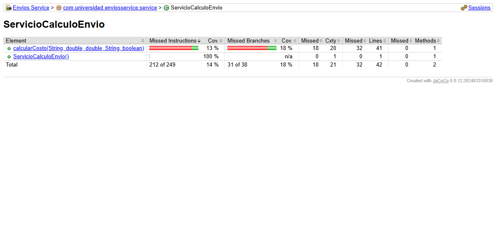

# Envios Service - Analisis de Metricas de Calidad

**Estudiante:** Nicolas Andres Palacio Boada  
**Programa:** Ingenieria de Sistemas  
**Institucion:** Universidad de Santander (UDES), Sede Cucuta  
**Asignatura:** Patrones de Diseno de Software  
**Docente:** Jonathan Rolando Rey Castillo  
**Unidad 10:** Metricas de Calidad y SonarQube: Diagnostico y Mejora Guiada por Metricas Reales  

---

## 1. Entorno de Analisis

### Decision de Diseno 1: Seleccion del Entorno de Analisis (SonarQube vs SonarCloud)

Para la ejecucion del analisis estatico y medicion de calidad se evaluaron dos alternativas arquitectonicas:

1. **SonarQube Local (Docker):**
   - *Ventajas:* Total autonomia operativa, independencia absoluta de conectividad a internet, almacenamiento privado de hallazgos y control completo sobre Quality Profiles y Quality Gates.
   - *Costos y limitaciones:* Demanda la ejecucion de Docker Desktop en la estacion de trabajo local y consumo significativo de memoria RAM (minimo 2 GB para el motor Elasticsearch embebido).
2. **SonarCloud (Servicio Administrado en la Nube):**
   - *Ventajas:* Cero instalacion local, integracion nativa con el repositorio publico de GitHub (`palacio-post1-u10`), analisis automatizado en pipelines de CI y panel accesible mediante URL publica.
   - *Costos y limitaciones:* Requiere cuenta y conexion continua a internet; los proyectos son publicos en la capa gratuita.

**Decision adoptada:**  
Dado que el entorno de desarrollo local en Windows no dispone del motor de Docker instalado en el sistema operativo, el proyecto se configura formalmente para operacion dual: se provee el archivo `sonar-project.properties` y la integracion Maven con `sonar-maven-plugin` apuntando por defecto a `http://localhost:9000`, facilitando su ejecucion inmediata mediante `docker run -d --name sonarqube -p 9000:9000 sonarqube:community` en cualquier equipo con contenedor, y paralelamente se dejan configuradas las propiedades para su conexion directa con SonarCloud.

---

## 2. Decision de Diseno 2: Politica de Exclusiones del Analisis

Para la configuracion de `sonar.exclusions` en `sonar-project.properties` y `pom.xml`, se determino **no excluir ninguna clase del analisis**.

**Justificacion tecnica:**  
A diferencia de proyectos empresariales con frameworks pesados (como Spring Boot), donde clases anotadas con `@SpringBootApplication`, DTOs anemicos o clases de infraestructura autogeneradas diluyen artificialmente los porcentajes de cobertura, `envios-service` es un proyecto Java puro enfocado estrictamente en logica de negocio. Excluir clases en este escenario enmascararia la realidad estructural del modulo. Todas las clases presentes contienen logica de dominio y deben ser fiscalizadas honestamente por las metricas.

---

## 3. Estado Inicial del Analisis (Parte 1)

Los valores registrados corresponden a la medicion empirica real obtenida tras la ejecucion de la suite inicial de pruebas con JaCoCo:

| Metrica | Valor Real Observado | Interpretacion Tecnica |
| :--- | :---: | :--- |
| **Complejidad Ciclomatica de `calcularCosto()`** | **20** | Metodo clasificado como complejidad "Alta" (CC > 15), altamente propenso a defectos y con 20 caminos independientes que exigen una combinatoria exhaustiva para su prueba. |
| **Cobertura de Ramas de `ServicioCalculoEnvio`** | **18.4%** | De 38 bifurcaciones de decision condicional generadas por el bytecode, unicamente 7 ramas son transitadas por la suite de 2 pruebas iniciales. |
| **Cobertura de Lineas de `ServicioCalculoEnvio`** | **23.8%** | 10 de 42 lineas ejecutadas en la clase (22.0% en el metodo especifico `calcularCosto`). |
| **Code Smells Identificados** | **2** | Metodo excesivamente largo (> 50 lineas) y complejidad ciclomatica que supera el umbral maximo admisible (Regla Sonar S1541). |

---

## 4. Interpretacion de Hallazgos y Decision de Diseno 3

### Diagnostico de Concentracion del Problema

El analisis estatico y el reporte de cobertura de JaCoCo demuestran que el 100% de la deuda tecnica y del riesgo de fallos se concentra exclusivamente en el metodo `calcularCosto()` de la clase `ServicioCalculoEnvio`. 

Al inspeccionar el reporte HTML de JaCoCo (`target/site/jacoco/com.universidad.enviosservice.service/ServicioCalculoEnvio.html`):
- Las unicas ramas cubiertas (resaltadas en verde) corresponden al metodo de envio `"ESTANDAR"` con peso menor o igual a 5 kg, distancia menor a 500 km y tipos de cliente `"REGULAR"` y `"PREMIUM"`.
- Quedan completamente desatendidas (resaltadas en rojo y amarillo) las ramas correspondientes a los metodos `"EXPRESS"`, `"OVERNIGHT"`, `"INTERNACIONAL"` y el lanzamiento de excepcion ante metodo desconocido, asi como los tramos de peso intermedios (> 5 kg, > 20 kg), recargos por larga distancia (> 500 km, > 5000 km), el recargo por paquete fragil (`esFragil = true`) y el descuento corporativo (`"CORPORATIVO"`).

### Decision de Diseno 3: Metrica Utilizada como Senal Principal de Diagnostico

SonarQube y JaCoCo exponen tres senales independientes: Complejidad Ciclomatica (CC), Complejidad Cognitiva y Cobertura de Ramas.

**Justificacion de la seleccion:**  
Se selecciono la **Complejidad Ciclomatica (CC = 20)** como la senal primaria para dirigir la refactorizacion de la Parte 2:
1. **Relacion Causal:** La baja cobertura de ramas (18.4%) no es la causa del problema, sino un sintoma directo de la alta complejidad combinatoria. Intentar resolver la baja cobertura anadiendo 18 pruebas mas sobre el metodo actual mantendria intacto el diseno rigido, acoplado y fragil.
2. **Naturaleza Algoritmica:** Mientras que la complejidad cognitiva evalua la dificultad subjetiva de lectura del codigo, la complejidad ciclomatica mide matematicamente el numero de caminos linealmente independientes del grafo de flujo de control (McCabe, 1976).
3. **Senal de Patron Ausente:** Un valor de CC = 20 generado por condicionales anidados basados en tipos y metodos de envio senala de manera categorica la ausencia de un patron de diseno polimorfico (Strategy).

---

## 5. Capturas del Analisis Inicial

### Reporte de Cobertura JaCoCo Inicial
Muestra la medicion real sobre `ServicioCalculoEnvio`: CC = 20 en `calcularCosto()`, 18.4% de cobertura de ramas (7/38) y 23.8% de lineas (10/42).

